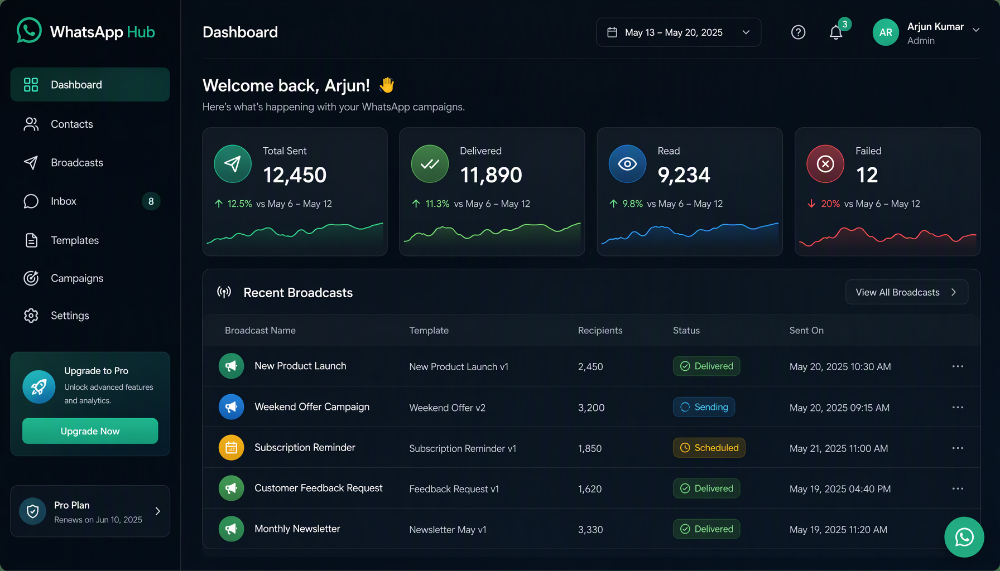

# WhatsApp Hub (الإصدار الثاني)

<div dir="rtl">

منصة رسائل واتساب **متعددة المستأجرين** ومستضافة ذاتياً على **Meta Cloud API** — المنتج من المرحلة الثانية، نسخة نظيفة مبنية من قاعدة كود V1 `wa-broadcast`. ارفع جهات الاتصال → اختر قالب معتمد → أرسل رسائل جماعية → تتبع التسليم وطلبات الإلغاء → رد ثنائي الاتجاه في صندوق وارد حي، يتطور إلى **مركز تفاعل محادثات** كامل.

<p align="center">
  
</p>

> **خريطة الطريق والمواصفات الكاملة:** [`whatsapphub-V2-ar.html`](./public/whatsapphub-v2-ar.html). راجع أيضاً [`CLAUDE.md`](./CLAUDE.md).

## المميزات الرئيسية

- **تعدد العملاء** — كل عميل لديه جهات الاتصال، القوالب، الرقم، والفريق الخاص به
- **صندوق وارد ثنائي الاتجاه** — محادثات حية مع تتبع النوافذ الخدمية 24 ساعة
- **قوالب غنية** — رؤوس وسائط، أكواد كوبونات، شرائط عرض
- **جدولة الحملات** — حملات متكررة ومجدولة
- **تحليلات مفصلة** — قمع التسليم، معدلات القراءة، تتبع أحداث الأزرار
- **متعدد اللغات** — واجهة عربية/إنجليزية كاملة

## التقنيات المستخدمة

Next.js (App Router) · TypeScript strict · Prisma + Postgres · BullMQ + Redis · Docker Compose

## المتطلبات الأساسية

1. **حساب WhatsApp Business (WABA)** من Meta + رقم هاتف
2. **قالب رسالة معتمد** واحد على الأقل
3. **رمز وصول دائم** (System User token)، **App Secret**، و **Phone Number ID** + **WABA ID**

## البدء السريع (Docker)

```bash
cp .env.example .env                          # املأ WA_* و META_APP_SECRET
node scripts/hash-password.mjs 'YourPassword' # انسخ الناتج → ADMIN_PASSWORD_HASH
# عيّن أيضاً ADMIN_EMAIL و AUTH_JWT_SECRET طويل (≥32 حرف)
docker compose up --build                     # postgres, redis, app, worker
```

أول تحميل يعيد التوجيه إلى **/login**. سجل الدخول بـ `ADMIN_EMAIL` وكلمة المرور.
التطبيق: http://localhost:3000 · الصحة: http://localhost:3000/api/health

## التطوير المحلي (بدون Docker)

```bash
npm install
npm run prisma:migrate -- --name init
npm run dev          # web على :3000
npm run worker:dev   # worker (terminal منفصل)
```

## ربط واتساب + Webhook

الأسهل: **Settings → Connect WhatsApp** — الصق Phone Number ID، Business Account ID، **App ID**، رمز الوصول، وapp secret، ثم **Test connection**.

في Meta App Dashboard → WhatsApp → Configuration:
- **Callback URL:** `https://YOUR_DOMAIN/api/webhooks/whatsapp`
- **Verify token:** رمز التحقق الخاص بك
- اشترك في أحداث **messages**

محلياً، استخدم `ngrok http 3000` وعنوان https.

## التدفق الاستخدامي

0. **إنشاء قالب (اختياري):** في **/templates**، أنشئ قالب برأس وسائط اختياري، متغيرات نص، تذييل، وأزرار
1. **مزامنة القوالب:** `GET /api/templates?sync=1`
2. **رفع جهات الاتصال:** `POST /api/contacts/upload`
3. **إنشاء بث:** `POST /api/broadcasts`
4. تابع التقدم في لوحة التحكم

## المصادقة والصلاحيات

مستخدمون مخزنون في قاعدة البيانات مع مسؤول تمهيدي من البيئة. كلمات المرور مشفرة بـ bcrypt؛ JWTs موقعة بـ `AUTH_JWT_SECRET`.

**تقسيم الرموز:**
- **رمز الوصول** — 15 دقيقة
- **رمز التحديث** — 7 أيام مع اكتشاف إعادة الاستخدام
- **تسجيل الخروج** — من هذا الجهاز أو من كل الأجهزة

## الصفحات

- **/** — صفحة هبوط ثنائية اللغة (EN/AR) مع تبديل فاتح/داكن
- **/dashboard** — إحصائيات، قوائم/رفع/بث، آخر البثوث
- **/inbox** — محادثات ثنائية الاتجاه حية
- **/broadcasts/[id]** — تقدم حي + تحليلات مفصلة
- **/contacts** — استيراد CSV أو إضافة فردية، تحرير، حذف جماعي
- **/templates** — إنشاء قوالب وإرسالها لـ Meta
- **/campaigns** — حملات متكررة (cron، UTC)
- **/settings** — ربط واتساب، أعضاء الفريق، إدارة العملاء

## تعدد المستأجرين

كل سجل مرتبط بـ **Client** (مستأجر); عميل تمهيدي `default` يملك البيانات الموجودة. الأدوار: **SUPERADMIN** / **ADMIN** / **MEMBER**.

## صندوق الوارد ثنائي الاتجاه

`/inbox` عرض محادثات حي بعمودين. الرسائل الواردة (نص، صورة، مستند، صوت، فيديو، ملصق، ردود تفاعلية، تفاعلات، موقع) مصنفة حسب العميل. رد بـ **نص** أو **مرفقات** خلال النافذة 24 ساعة.

## القوالب

أنشئ في **/templates** وأرسل لـ Meta:
- **رأس وسائط** — صورة / PDF / فيديو
- **نص** مع `{{متغيرات}}` + **تذييل** اختياري
- **أزرار** (حتى 3): رد سريع / URL / **اتصال** / **نسخ كود**
- **شرائط عرض** — 2-10 بطاقات وسائط

## النظام التصميمي

العلامة التجارية: **NazzilVideo** (داكن، تدرج teal→green، Inter/Cairo)

## الحملات المتكررة

`RecurringCampaign` + طابور BullMQ. العامل يعيد مزامنة الجداول النشطة عند الإقلاع. الجداول تعمل بـ **UTC**.

## النشر (Railway)

راجع **RAILWAY.md**. المكونات: Postgres, Redis, **web**, **worker**.

## الاختبارات

```bash
npm run typecheck    # tsc strict
npm test             # vitest
npm run test:e2e     # playwright
```

## التوسع

- ارفع `WA_MPS` **فقط بعد** ترقية Meta لمستوى الإنتاجية
- شغّل عدة حاويات `worker` — BullMQ يوزع الوظائف

## بديل Serverless

شغّل `app` على Vercel; Postgres → Neon/Supabase, Redis → Upstash. **العامل يجب أن يبقى على host دائم** (Railway/Fly/VM).

## الترخيص

[MIT](./LICENSE) — مفتوح المصدر، مجاني للاستخدام التجاري والشخصي.

## المساهمة

المساهمات مرحب بها! راجع [CONTRIBUTING.md](./CONTRIBUTING.md) (قريباً).

## الدعم

- افتح issue على GitHub
- راجع التوثيق في `docs/`
- راجع [`ARCHITECTURE.md`](./ARCHITECTURE.md) للتصميم الكامل

---

<p align="center">
  <strong>⭐ إذا أعجبك المشروع، لا تنسَ إضافة نجمة على GitHub!</strong>
</p>

</div>
